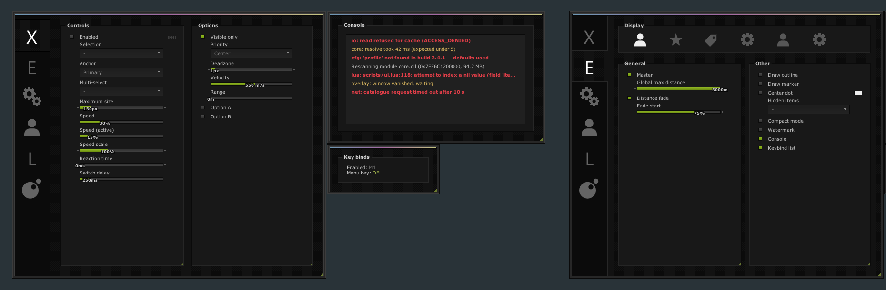

# gamesense-gui

A dark, dotted Dear ImGui menu: custom window chrome, sidebar tabs, group boxes, checkboxes, sliders, combos and snapping side windows. UI only — every control edits a local variable.



## Build (Windows, Visual Studio C++ tools)

```
git clone --recursive https://github.com/huncho416/gamesense-gui
build.bat
menu.exe
```

## Use in your own ImGui app

Add `menu.cpp` and `menu.h`, call `Menu::Init()` once after `ImGui::CreateContext()`, and `Menu::Render()` every frame. Fonts are loaded from `C:\Windows\Fonts`.
